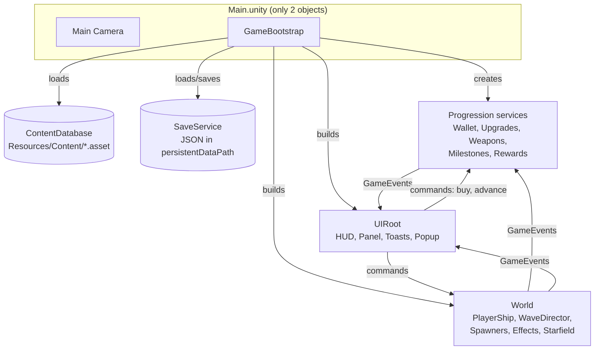

# Architecture

How the code is organized, how a frame flows, and why it's built this way. For the *rules* to follow when changing
code, see [CODING_STANDARDS.md](CODING_STANDARDS.md).

- [1. Goals](#1-goals)
- [2. Big picture](#2-big-picture)
- [3. Layers](#3-layers)
- [4. Startup sequence](#4-startup-sequence)
- [5. Runtime flow](#5-runtime-flow)
- [6. Communication: events vs. direct calls](#6-communication-events-vs-direct-calls)
- [7. Content (data-driven design)](#7-content-data-driven-design)
- [8. Persistence](#8-persistence)
- [9. Rendering & UI without art assets](#9-rendering--ui-without-art-assets)
- [10. Key decisions & trade-offs](#10-key-decisions--trade-offs)
- [11. Extension points](#11-extension-points)

---

## 1. Goals

1. **Easy to extend with content.** Adding a weapon, enemy, upgrade or milestone should need no code changes.
2. **Clear separation of concerns.** Gameplay doesn't know about UI. Enemies don't know about the wallet.
3. **Explicit dependencies.** No hidden global lookups. You can see what a class needs from its constructor or
   `Initialize` method.
4. **AI- and diff-friendly.** Behaviour lives in C#, content in text-based YAML assets, and the scene holds almost
   nothing, so changes are reviewable in git.
5. **Testable core math.** Formulas live in pure static classes with unit tests.

## 2. Big picture

## 3. Layers

One assembly (`AstroIdle.Runtime`) split into namespaces/folders with a strict **one-way** dependency order. A layer
may use anything *above* it in this list and nothing below it:

| # | Layer (namespace) | Responsibility | Examples |
|---|-------------------|----------------|----------|
| 1 | `AstroIdle.Utilities` | Generic helpers with no game knowledge. | `NumberFormatter`, `ShapeSpriteFactory`, `ScreenLayout` |
| 2 | `AstroIdle.Content` | ScriptableObject definitions plus the content registry. Pure data. | `WeaponDefinition`, `WaveConfig`, `ContentDatabase` |
| 3 | `AstroIdle.Events` | Global event hub and payloads. | `GameEvents`, `EnemyKilledInfo` |
| 4 | `AstroIdle.Persistence` | Save data model and file IO. | `SaveData`, `SaveService` |
| 5 | `AstroIdle.Progression` | Economy and meta-progression rules (no MonoBehaviours), including auto mode. | `CurrencyWallet`, `UpgradeService`, `MilestoneService`, `AutoBuyService` |
| 6 | `AstroIdle.Gameplay.*` | Real-time simulation: arena, combat, enemies, player, weapons, waves, effects. | `PlayerShip`, `Enemy`, `WaveDirector` |
| 7 | `AstroIdle.Core` | `GameContext`: the bag of top-level references handed to the UI. | `GameContext` |
| 8 | `AstroIdle.UI` | Presentation and input. Reads state, issues commands. | `HudView`, `BottomPanelView`, tabs, bindings |
| 9 | `AstroIdle.Bootstrap` | Composition root. Wires everything together. | `GameBootstrap` |

Editor tooling (`AstroIdle.Editor`, editor-only assembly) and tests (`AstroIdle.Tests.EditMode`) sit outside the
runtime and may reference any runtime layer.

Each folder has a README with details:
[Utilities](../Assets/_Project/Scripts/Runtime/Utilities/README.md) ·
[Content](../Assets/_Project/Scripts/Runtime/Content/README.md) ·
[Events](../Assets/_Project/Scripts/Runtime/Events/README.md) ·
[Persistence](../Assets/_Project/Scripts/Runtime/Persistence/README.md) ·
[Progression](../Assets/_Project/Scripts/Runtime/Progression/README.md) ·
[Gameplay](../Assets/_Project/Scripts/Runtime/Gameplay/README.md) ·
[Core](../Assets/_Project/Scripts/Runtime/Core/README.md) ·
[UI](../Assets/_Project/Scripts/Runtime/UI/README.md) ·
[Bootstrap](../Assets/_Project/Scripts/Runtime/Bootstrap/README.md) ·
[Editor](../Assets/_Project/Scripts/Editor/README.md)

## 4. Startup sequence

`GameBootstrap.Awake` → `Start` (see [Bootstrap README](../Assets/_Project/Scripts/Runtime/Bootstrap/README.md)):

1. App settings: 60 FPS target, screen never sleeps, time scale 1.
2. `ContentDatabase.LoadFromResources()` then `Validate()`. Errors are logged. Missing core content aborts startup.
3. `SaveService.Load()` returns existing or new `SaveData`.
4. Create services in dependency order: `CurrencyWallet` → `WeaponInventory` (grants a random starting weapon on a new game) →
   `UpgradeService` → `MilestoneService` → `RewardService` → `AutoBuyService`.
5. Configure the camera (`ArenaCamera`) and compute the `PlayArea`.
6. Create the world: spawners (with pools), effects, starfield, `PlayerShip`, `WaveDirector`. Bundle into
   `GameplayContext`.
7. Build the UI (`UIRoot.Build`).
8. `Start`: `WaveDirector.Begin()` starts the saved wave. Check offline earnings and show the popup.

## 5. Runtime flow

Per frame (each item is its own `Update`):

- **PlayerShip:** regen → autopilot steering → clamp to arena → face nearest enemy → tick each weapon
  (cooldown, find target, fire through `ProjectileSpawner`).
- **Enemy (×N):** behaviour moves it → visuals → contact check with the ship.
- **Projectile (×N):** lifetime → homing → move → hit check through `CombatRegistry`.
- **WaveDirector:** spawn on interval → detect clear → intermission → next wave. Handles ship destruction a frame
  later (never inside a damage call).
- **EffectsSystem:** animates pooled particles.
- **GameBootstrap:** income smoothing, auto mode shopping (every 0.5s when on), milestone check (4×/s),
  autosave (every 15s), screen-change relayout.
- **UI:** HUD refreshes at 10×/s, panel rows at 5×/s.

A kill, end to end:
`Projectile` hits → `Enemy.TakeDamage` → `Enemy.Explode(true)` → raises `GameEvents.EnemyKilled` →
`RewardService` adds credits (× credit multiplier) and counts the kill → `WaveDirector` counts progress via
`EnemyRemoved` → next milestone poll may complete a goal → `ToastView` and `BottomPanelView` react.

## 6. Communication: events vs. direct calls

| Use | When | Example |
|-----|------|---------|
| **Direct call** on an injected dependency | The caller needs an answer or owns the action. | `WeaponRuntime` asks `CombatRegistry.FindNearest`. UI calls `UpgradeService.TryPurchase`. |
| **`GameEvents`** | Announcing something happened to *unknown* listeners, usually upward across layers. | `EnemyKilled`, `WaveFailed`, `MilestoneCompleted`. |
| **Polling** | UI display, and logic where handler ordering would be fragile. | HUD reads `Wallet.Credits`. `MilestoneService.Evaluate()` runs 4×/s. |

Lower layers never call higher layers directly. When they need to notify upward, they raise an event.

## 7. Content (data-driven design)

- All content is ScriptableObject assets in `Assets/_Project/Resources/Content/<Type>/`, loaded by folder at
  startup. **Drop a new asset in the right folder and it's in the game.** No lists to register it in.
- Cross-references use **string ids** (`splitIntoEnemyId`, `unlockWeaponId`, spawn table `enemyId`), not asset
  references. Ids are stable for save files, easy to read in YAML, and checked by `ContentDatabase.Validate()`.
- Pricing is centralized: weapon unlocks use one shared price in `EconomyConfig`, and weapon upgrade tracks
  reference shared **cost curves** there by id, so equivalent upgrades cost the same on every weapon.
- Stats are modified through **upgrade tracks** owned by the ship or a weapon. A track changes one `StatId` by a
  `Flat` or `Percent` amount per level. `UpgradeService` is the single place final stats are computed.
- Authoring guide: [Content README](../Assets/_Project/Resources/Content/README.md).

## 8. Persistence

- `SaveData` is a plain serializable class (JsonUtility) holding credits, progress, upgrade levels (key
  `"{ownerId}.{trackId}"`), owned/unlocked weapons, completed milestones, and the last save time.
- Saved on a 15s timer, when the app is paused/backgrounded (the reliable hook on Android), and on quit. Writes go
  through a temp file to avoid corruption.
- **Versioning:** `SaveData.CurrentVersion` plus `SaveService.Migrate()`. Add-only changes need no migration.
- Services mutate the shared `SaveData` instance directly. It's the single source of truth for persistent state.

## 9. Rendering & UI without art assets

- **Sprites** are generated at runtime by `ShapeSpriteFactory` (glowing vector polygons, cached), tinted by
  `SpriteRenderer.color`. This gives the *Asteroids* look and means no art pipeline is needed yet. Real art can
  replace it later by giving definitions a `Sprite` field and falling back to the generated shape.
- **Effects** use pooled `SpriteRenderer` particles instead of `ParticleSystem`, so no materials are needed.
- **UI** is uGUI built entirely from code (`UiFactory`) with the built-in `LegacyRuntime.ttf` font, so no
  TextMeshPro import step is needed.
- Built-in render pipeline (no URP), the simplest setup for 2D sprites. Switching to URP 2D later only needs
  sprite materials updated.

## 10. Key decisions & trade-offs

| Decision | Why | Cost / revisit when |
|----------|-----|---------------------|
| Code-built scene and UI (no prefabs) | Reliable, diffable and AI-editable. No fragile scene YAML or broken references. | Designers can't lay out UI visually. Introduce prefabs for complex screens if needed. |
| `Resources/` folder loading | Zero-config content discovery. | `Resources` is loaded wholesale. Move to Addressables if content grows into hundreds of MB. |
| Manual circle collisions (no Physics2D) | Predictable, cheap, no layer/collision-matrix setup. | O(projectiles × enemies). Add a spatial grid in `CombatRegistry` if counts exceed a few hundred. |
| Static `GameEvents` | Simple and discoverable. Cleared on play start. | Must unsubscribe diligently. Consider an injected event bus if it grows large. |
| Polling UI | Simple, decoupled, cheap at 5–10 Hz. | Fine for this scale. |
| `float` enemy health | Matches Unity math APIs. | Health × 1.15^w overflows float near wave 600. Switch combat numbers to `double` before then. |
| Legacy uGUI `Text` | No TMP setup step. | Swap to TextMeshPro for sharper text when doing a visual polish pass. |
| Single runtime assembly | Simpler for a small project. Namespaces enforce layers. | Split into multiple asmdefs if compile times or layering discipline become a problem. |

## 11. Extension points

| To add... | Do this | Code change? |
|-----------|---------|--------------|
| Weapon, enemy, milestone, ship/weapon upgrade | Create or edit an asset ([content guide](../Assets/_Project/Resources/Content/README.md)). | No |
| Enemy AI | Append to `EnemyBehaviourType`, implement `IEnemyBehaviour`, register in `EnemyBehaviourFactory`. | Yes, small |
| Stat that upgrades can modify | Append to `StatId`, return its base in the definition's `GetBaseStat`, consume it in gameplay, format it in `StatFormatter`. | Yes, small |
| Milestone condition | Append to `MilestoneCondition`, handle it in `MilestoneService.GetCurrentValue`. | Yes, small |
| Projectile motion | Append to `ProjectileMotion`, handle it in `Projectile.Update`. | Yes, small |
| Shape | Append to `ShapeType`, add a polygon in `ShapeSpriteFactory.GetPolygon`. | Yes, small |
| UI tab (optionally with a left-hand sub-tab list) | Implement `IPanelTab` (and `ISubTab` per entry), add it in `BottomPanelView.CreateTabs`. | Yes, small |
| Currency (e.g. prestige) | Add fields to `SaveData`, extend or add a wallet, add UI. | Yes, medium |
